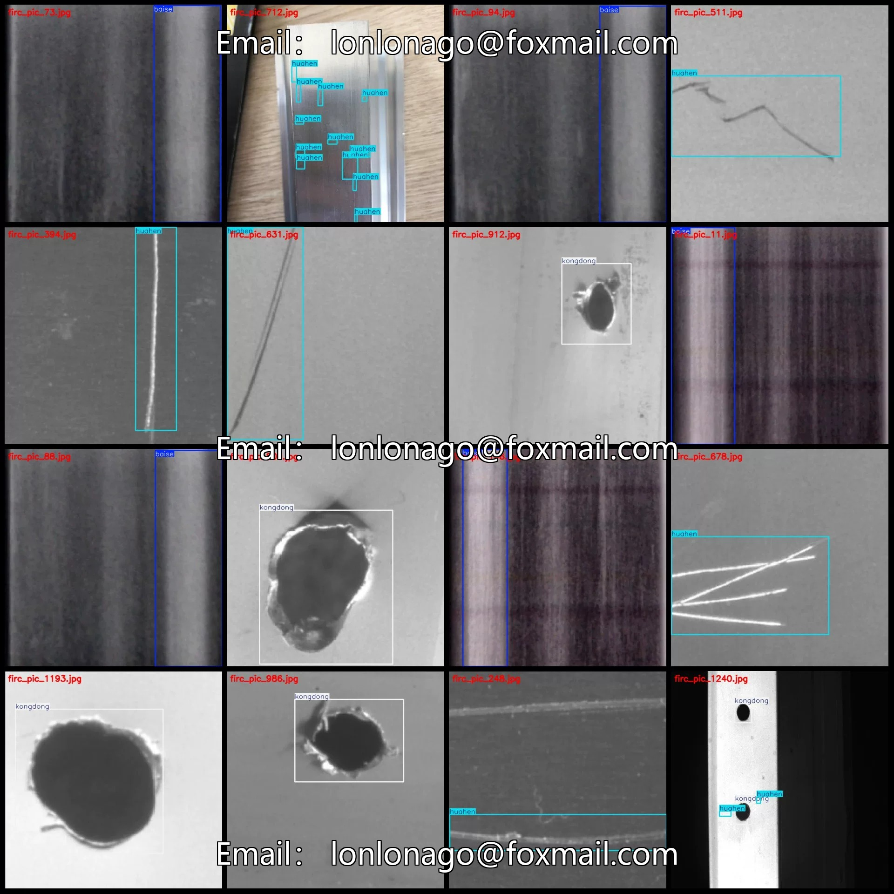
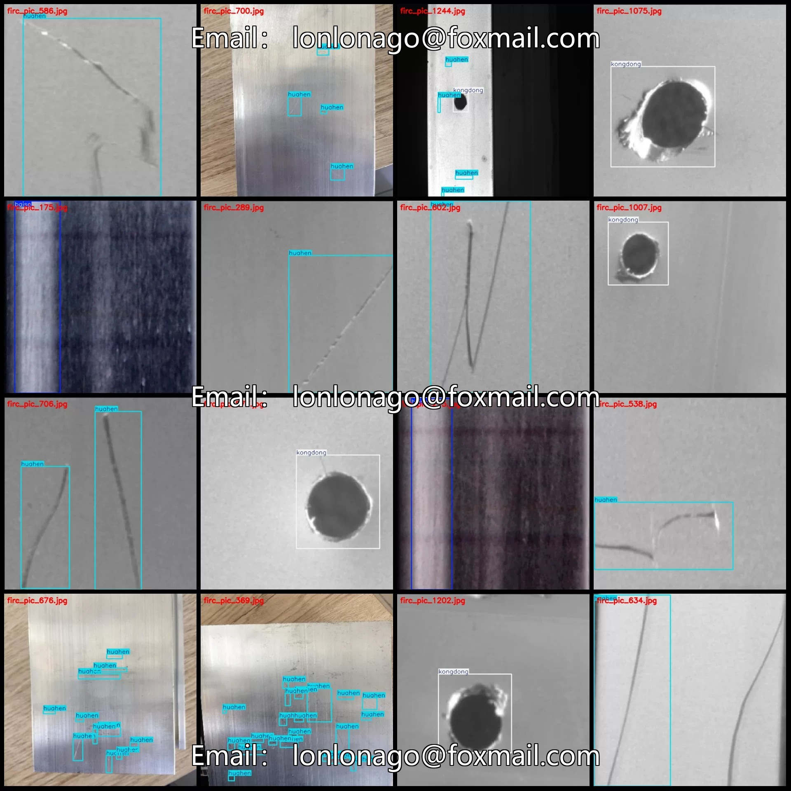
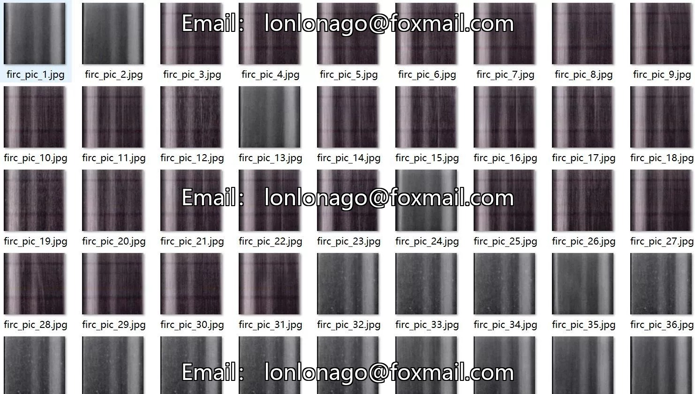
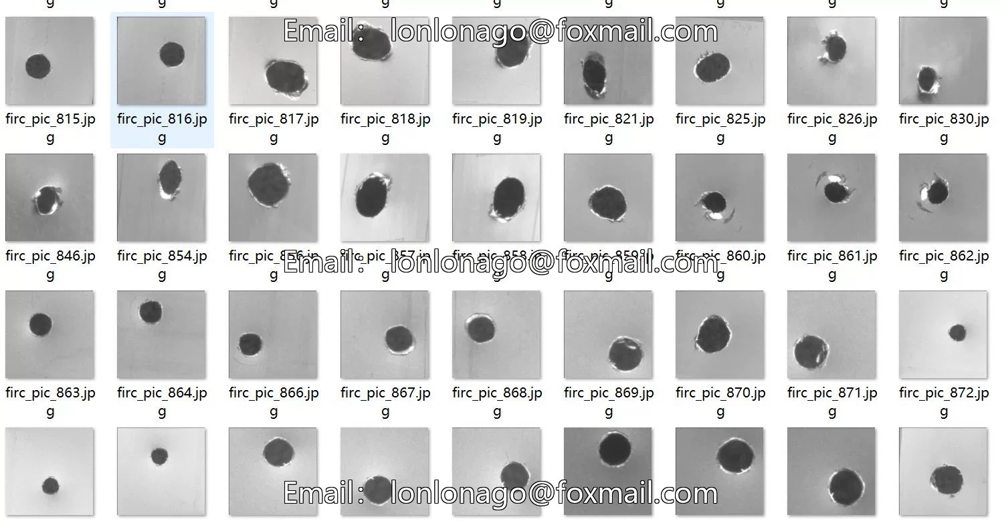
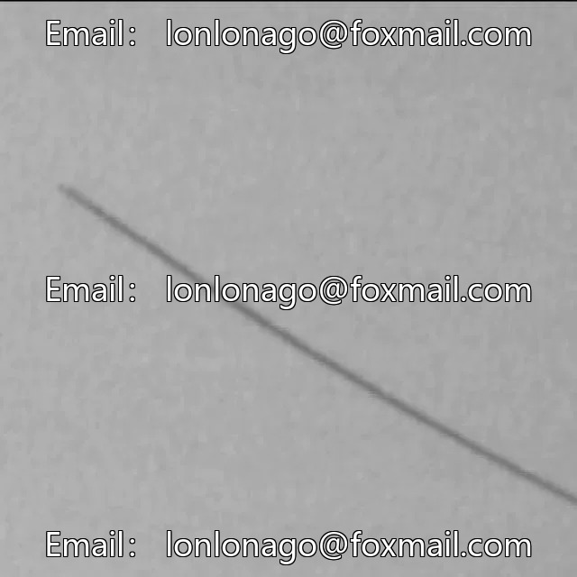
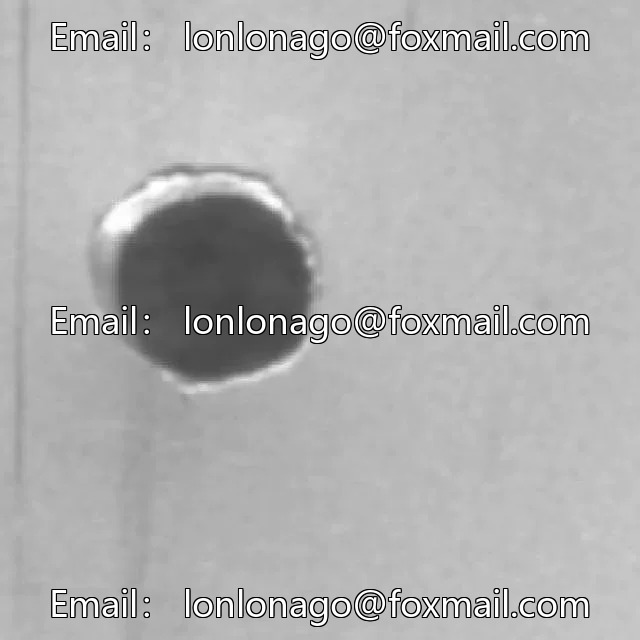

# Industrial Metal Surface Defect Detection Dataset VOC+YOLO format with 1259 images in 3 classes

## Body

Industrial Metal Surface Defect Detection Dataset - VOC+YOLO format - 1259 images in 3 categories
Tips: Due to the dataset's replicability, please confirm compliance before purchasing.
Dataset format: Pascal VOC format + YOLO format (txt file without split path, only containing jpg images and corresponding VOC format xml files and yolo format txt files)
Number of images (number of jpg files): 1259
Number of annotations (number of xml files): 1259
Number of annotations (number of txt files): 1259
Number of annotation categories: 3

Label Category Names: ["baise", "huahen", "kongdong"]
Note: The order of categories in the Yolo format does not correspond to this, but is based on the labels folder's classes.txt file.

Each category labeled with boxes and images:
- baise: Boxes = 221, Images = 220
- huahen: Boxes = 889, Images = 535
- kongdong: Boxes = 550, Images = 524
Total Boxes: 1660
Image Resolution: 640x640
Using Annotation Tool: labelImg
Annotation Rules: Draw a box around each category.

Important Notice: The dataset does not have separate training, validation, and test sets; you need to partition them yourself.
Special : This dataset does not guarantee the accuracy of the trained models or weight files.

## Images

## Payment

Here is a pay link on Stripe ( https://buy.stripe.com/3cs8yP7sY87d0vu9AB ). Please contact me lonlonago@foxmail.com after funding $89, and I will send you a complete data files , thank you!

